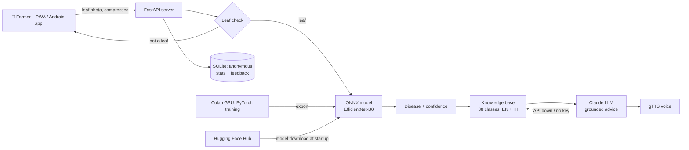

<div align="center">

# 🌾 KrishiMitra
### AI Crop Disease Detection & Farmer Advisor
**Click a leaf, save your crop. · पत्ती की फ़ोटो लें, फसल बचाएँ।**


[🌐 **Live demo**](https://techyyashh-krishimitra.static.hf.space) · [🤗 Space](https://huggingface.co/spaces/Techyyashh/krishimitra) · [🤗 Model](https://huggingface.co/Techyyashh/krishimitra-model) · 📱 Play Store (coming soon)

> The live demo runs the AI **inside your browser** (onnxruntime-web): photos never leave the phone and it works
> offline after the first visit. AI chat and Claude-written advice need the full server version (`uvicorn api.main:app`).

</div>

---

## 🌍 The problem
Indian farmers lose **20–40% of their crop** to pests and diseases. Diseases are spotted late, experts are far
away, and most advice apps are in English and need reading.

## 💡 The solution
A farmer takes a photo of a leaf. KrishiMitra:
1. **Checks it is a leaf** (rejects random photos)
2. **Detects the crop and disease** – 14 crops, 38 classes – with a confidence score and top-3 alternatives
3. Says **"not sure, retake the photo"** when confidence is low, instead of guessing
4. Shows a **disease card**: signs, cause, organic steps, chemical options, prevention, severity
5. Gives **simple advice in Hindi or English** (AI-generated, grounded in a trusted knowledge base)
6. **Reads the advice aloud** 🔊 for farmers who prefer listening
7. Answers **follow-up questions** (RAG chat)
8. Collects **"was this correct?" feedback** to improve the model

Works as a website, installs like an app (PWA), and ships to the **Google Play Store** (Trusted Web Activity).

## 🏗️ Architecture


## 📊 Results
> Fill these in from `reports/*_metrics.json` after training. Do not invent numbers.

| Model | PlantVillage test acc | Macro-F1 | Top-3 acc | PlantDoc (real field) acc | Size | CPU latency |
|---|---|---|---|---|---|---|
| EfficientNet-B0 | – | – | – | – | – MB | – ms |
| MobileNetV3-Large | – | – | – | – | – MB | – ms |

## 🛠️ Tech stack
| Layer | Tools |
|---|---|
| Training | PyTorch, timm (EfficientNet-B0 / MobileNetV3), Albumentations, Grad-CAM, Google Colab |
| Inference | ONNX Runtime (CPU, no PyTorch on the server), INT8 quantization |
| AI advice | Claude API with grounded prompts, TF-IDF retrieval (RAG), static fallback |
| Voice | gTTS (Hindi + 10 Indian languages) |
| Backend | FastAPI, Pydantic, slowapi rate limiting, SQLite |
| Frontend | Vanilla JS PWA (no build step), service worker, Hindi/English UI |
| Android | Trusted Web Activity via Bubblewrap |
| DevOps | Docker, GitHub Actions (CI + auto-deploy), Hugging Face Spaces + Hub |

## 🚀 Quick start (Windows, PowerShell)
```powershell
# 1. Python 3.11 environment
py -3.11 -m venv .venv
.\.venv\Scripts\Activate.ps1
pip install -r requirements.txt
python check_env.py

# 2. Secrets (optional – without a key the app uses static advice)
copy .env.example .env      # then add ANTHROPIC_API_KEY

# 3. Tests
pytest
```

### No model yet? Use the starter model (2 minutes)
```powershell
pip install transformers==4.46.3
python scripts/import_pretrained.py
```
This converts the open, Apache-2.0 [neghani/plantvillage-mobilenetv2](https://huggingface.co/neghani/plantvillage-mobilenetv2)
(same 38 classes) into `models/krishimitra.onnx`, so the app works immediately. Its model card reports 99.2% on the
PlantVillage test split but only ~16% on a small real-field set, so replace it with your own trained model.

### Train the model (Google Colab, free GPU)
Open `notebooks/train_on_colab.ipynb` in Colab (File → Upload notebook), set the runtime to **T4 GPU** and run all cells.
Then download `krishimitra.onnx` and `classes.json` from `MyDrive/krishimitra/artifacts` into `models/`.

Or run the same steps by hand:
```bash
python -m src.data.dataset                                   # splits
python -m src.models.train --arch efficientnet_b0            # train
python -m src.models.evaluate --checkpoint models/efficientnet_b0_best.pth
python -m src.models.evaluate --checkpoint models/efficientnet_b0_best.pth --external-dir data/raw/plantdoc/test --name plantdoc
python -m src.models.export --checkpoint models/efficientnet_b0_best.pth
```

### Run the app
```powershell
uvicorn api.main:app --reload          # web app → http://127.0.0.1:8000 , API docs → /api/docs
streamlit run streamlit_app/app.py     # quick demo UI
docker compose up --build              # full container → http://localhost:8000
```

### Deploy & publish
| Step | Guide |
|---|---|
| **Free** live demo (AI in the browser): `python scripts/build_static.py --deploy --space Techyyashh/krishimitra` | [docs/DEPLOYMENT.md](docs/DEPLOYMENT.md) |
| Full server version (Docker: Render, or Hugging Face with PRO) + model on the Hub + CI/CD | [docs/DEPLOYMENT.md](docs/DEPLOYMENT.md) |
| Android app on Google Play | [docs/ANDROID_PLAY_STORE.md](docs/ANDROID_PLAY_STORE.md) |
| Launch posts, pitch, resume lines, viva questions | [docs/LAUNCH_KIT.md](docs/LAUNCH_KIT.md) |

## 📡 API
| Method | Endpoint | Purpose |
|---|---|---|
| POST | `/api/predict` | Leaf photo → status, disease, confidence, top-3, info card |
| POST | `/api/advice` | `{label, lang}` → farmer-friendly advice (AI or static) |
| POST | `/api/chat` | `{question, lang, label?}` → grounded answer |
| POST | `/api/tts` | `{text, lang}` → MP3 audio |
| POST | `/api/feedback` | Was the prediction correct? |
| GET | `/api/labels` · `/api/stats` · `/api/health` | Class list · anonymous usage · health check |

## 📁 Project structure
```
krishimitra/
├── src/
│   ├── data/          labels, dataset scanning + stratified splits, augmentations
│   ├── models/        model, train, evaluate, gradcam, export (ONNX + INT8)
│   ├── inference/     ONNX predictor, leaf validator, safe image loading
│   ├── llm/           knowledge base, prompts, Claude client, advisor, RAG chat
│   ├── speech/        text-to-speech
│   └── utils/         config + logging
├── api/               FastAPI app, routes, schemas, upload security, rate limiting, SQLite
├── web/               PWA (index.html, app.js, service worker, manifest, privacy page, icons)
├── streamlit_app/     quick demo UI
├── knowledge_base/    disease_info.json (38 classes, EN + HI) + extra docs for chat
├── notebooks/         Colab training notebook
├── scripts/           deploy to HF Space, upload model, generate icons
├── deploy/hf_space/   Docker Space README (server version)
├── mobile/twa/        Android (Trusted Web Activity) config templates
├── docs/              deployment, Play Store, architecture, launch kit
├── tests/             pytest (no GPU / PyTorch needed)
├── configs/config.yaml
├── Dockerfile · docker-compose.yml · .github/workflows/
└── requirements*.txt
```

## 🗺️ Roadmap
- [x] Training pipeline, evaluation on real field images, Grad-CAM, ONNX export
- [x] API, PWA, Hindi/English advice, voice, chat, feedback
- [x] Docker, CI/CD, Hugging Face deployment, Play Store packaging
- [ ] Verify every knowledge-base entry with KVK / agri-university sources
- [ ] Fine-tune on field photos collected via feedback
- [ ] Offline in-app diagnosis (onnxruntime-web)
- [ ] More languages (Marathi, Tamil, Telugu…) and voice questions (Whisper)
- [ ] Weather-based disease risk alerts

## ⚠️ Disclaimer
KrishiMitra gives general, AI-generated guidance and can be wrong. Always confirm with your local
**Krishi Vigyan Kendra (KVK)** or agriculture officer before using any chemical, and follow the dose on the product label.
Kisan Call Centre: **1800-180-1551**.

## 🙏 Acknowledgements
- PlantVillage dataset – Hughes & Salathé, *An open access repository of images on plant health* (2015)
- PlantDoc dataset – Singh et al., *PlantDoc: A Dataset for Visual Plant Disease Detection* (CoDS-COMAD 2020)
- [timm](https://github.com/huggingface/pytorch-image-models), [ONNX Runtime](https://onnxruntime.ai), [FastAPI](https://fastapi.tiangolo.com)

## 📄 License
[MIT](LICENSE) – see [data/DATA_SOURCES.md](data/DATA_SOURCES.md) for dataset licenses.
